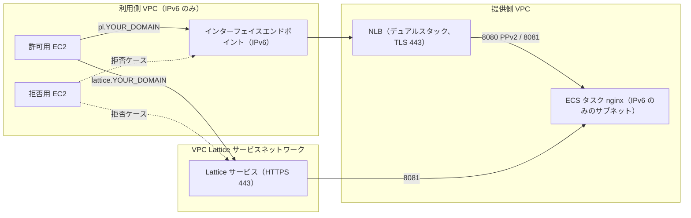

# 検証シナリオ: IPv6 VPC 間の ECS サービス呼び出し — AWS PrivateLink と Amazon VPC Lattice の比較

- 版: 1.0（2026-11-24）
- 対象読者: このシナリオを実施する人（作成者以外も含む）
- 比較の観点: 遅延、アクセス制御、提供側での呼び出し元の識別
- 前提知識: AWS コンソールまたは AWS CLI の基本操作。各手順にリンクした公式ドキュメント
- AWS の仕様に関する記述は 2026-11-24 時点で確認したもの。確認できていない点には「要確認」と書いている
- この文書は手順を記述するだけで、作成者は AWS 上で実行していない。実測値は含まない

---

## 1. 目的と判定の考え方

方式を最終的に決めるのは顧客側の担当者です。この文書は、その判断材料をそろえるための手順書です。

| 観点 | 何を確かめるか | 判定 |
|------|----------------|------|
| 遅延 | 確立済みの接続で 1 件ずつ送ったときの往復時間 | 合否は付けない。値と 2 方式の差を記録する（要件分析で決定）。手順どおりに 3 セットを測り、記録欄がすべて埋まれば「完了」とする |
| アクセス制御 | ネットワークのレベル、経路のポリシー、接続の承認の 3 種類 | 各ケースの期待結果（200 / 403 / 接続不可）と一致すれば合格 |
| 呼び出し元の識別 | アプリから見える送信元情報 | 想定どおりか、想定外かを記録する（6 章の表） |

## 2. 前提と構成

### 2.1 前提

| 項目 | 内容 |
|------|------|
| アカウント・リージョン | 同じ AWS アカウント、東京（ap-northeast-1） |
| VPC | 利用側 VPC と提供側 VPC の 2 つ。どちらも IPv6 のみ（例外は 2.3） |
| アベイラビリティーゾーン | すべて同じアベイラビリティーゾーン 1 つ（例: ap-northeast-1a）。以下 `<AZ>` と書く |
| 呼び出し元 | 許可用 EC2（m7i.large、Amazon Linux 2023）と、拒否用 EC2（同じスペック）。拒否用 EC2 は、別のセキュリティグループと別の IAM ロールを付ける |
| 呼び出し先 | Fargate 上の ECS サービス。プラットフォームバージョン 1.4.0 以降、0.5 vCPU / 1 GB のタスクを 1 つ、nginx を使う |
| プロトコル | HTTP/1.1。TLS は経路の途中（NLB、Lattice）で終端する |
| 名前 | Route 53 のプライベートホストゾーン `<YOUR_DOMAIN>` に、`pl.<YOUR_DOMAIN>` と `lattice.<YOUR_DOMAIN>` を作る |
| 証明書 | ACM で発行する。`pl.<YOUR_DOMAIN>` と `lattice.<YOUR_DOMAIN>` を対象にし、公開 DNS で検証できるドメインを使う |
| データ | 業務データは使わない |

文書中の `<ACCOUNT_ID>`、`<YOUR_DOMAIN>`、`vpc-xxxx` などは、自分の値に置き換えます。

### 2.2 構成図



<!-- Text fallback: 利用側 VPC の EC2 から、2 つの経路で提供側の ECS タスクを呼び出す。PrivateLink 経路は「インターフェイスエンドポイント → NLB（TLS 終端）→ タスクの 8080（Proxy Protocol v2 あり）または 8081」。Lattice 経路は「Lattice サービス（HTTPS 終端）→ タスクの 8081」。拒否用 EC2 は拒否ケースだけに使う。 -->

### 2.3 IPv6 のみにできない部分

| 部分 | 内容 | 理由 | 記録欄 |
|------|------|------|--------|
| PrivateLink 提供側の NLB サブネット | IPv4 を併用するデュアルスタックにする | NLB はデュアルスタックが必須で、IPv6 のみのサブネットには作れないため（[参考](https://aws.amazon.com/blogs/networking-and-content-delivery/accelerate-ipv6-application-migration-with-aws-privatelink-and-dual-stack-network-load-balancers-udp-support/)） | 8.4 |
| Lattice の利用側 VPC（条件付き） | 3.2 の確認で IPv6 のみに対応していなかった場合だけ、デュアルスタックにする | IPv6 のみの VPC への対応について、公式情報どうしの記載が食い違っているため（要確認） | 8.4 |

## 3. 事前確認

### 3.1 Fargate の IPv6 のみ構成

| 事前条件 | 操作 | 期待する結果 |
|----------|------|-------------|
| 提供側 VPC に、IPv6 のみのサブネットがある | [ECS のドキュメント](https://docs.aws.amazon.com/AmazonECS/latest/developerguide/fargate-task-networking.html)で、IPv6 のみの構成に対応しているかを確認する | 対応していると書かれている（VPC 側の対応表と記載が食い違っている。要確認） |
| ECR に nginx のイメージを登録済み | タスク定義で、イメージ URI に ECR のデュアルスタックエンドポイントを指定する | タスクが RUNNING になる。ECS Exec は使えない前提で進める |

### 3.2 VPC Lattice の IPv6 のみ構成

| 事前条件 | 操作 | 期待する結果 | 想定と違う場合 |
|----------|------|-------------|----------------|
| 利用側 VPC が IPv6 のみ | 4.3 の手順で VPC を関連付けたあと、許可用 EC2 から `dig AAAA lattice.<YOUR_DOMAIN>` を実行し、続けて 5.1 の疎通確認を行う | AAAA レコードが返り、HTTP 200 が返る | 利用側に IPv4 のサブネットを追加してデュアルスタックにし、続ける。そのことを 8.4 に記録する |

## 4. 構築手順

各手順は「事前条件 → 操作 → 期待する結果」の順に書いています。権限は 9 章の IAM ポリシー例を使います。

### 4.1 共通

1. **VPC を作る**
   - 事前条件: なし
   - 操作:
     - 利用側 VPC（IPv6 のみのサブネット `<AZ>`）を作る。
     - 提供側 VPC を作る。サブネットは IPv6 のみのサブネット（タスク用）と、デュアルスタックのサブネット（NLB 用）を、どちらも `<AZ>` に作る。
     - それぞれに Egress-only インターネットゲートウェイを付け、`::/0` のルートを向ける。
   - 期待する結果: 各サブネットに IPv6 の CIDR が割り当てられている。
2. **EC2 を 2 台起動する**
   - 事前条件: 利用側 VPC がある
   - 操作:
     - 許可用 EC2 にはセキュリティグループ `sg-allow-client` と IAM ロール `pl-lattice-allow-role` を付ける。
     - 拒否用 EC2 にはセキュリティグループ `sg-deny-client` と IAM ロール `pl-lattice-deny-role` を付ける。
     - どちらも IPv6 のみのサブネットに置く。
   - 期待する結果: 両方とも IPv6 アドレスだけを持ち、Session Manager で接続できる。
3. **呼び出し先のアプリを用意する**
   - 事前条件: 手元の端末で nginx 公式イメージ（1.23.2 以降）を取得できる
   - 操作:
     - 次の設定を含むイメージを ECR に登録する。
     - 8080 は `proxy_protocol` 付き、8081 は付けずに待ち受ける。
     - どちらも次の JSON を返す: `remote_addr`、`proxy_protocol_addr`、`proxy_protocol_tlv_aws_vpce_id`、`http_x_amzn_source_vpc`、`http_x_forwarded_for`。
   - 期待する結果: ECR にイメージがある。

   ```nginx
   # 抜粋（8081 側。8080 は listen に proxy_protocol を付ける）
   location / { default_type application/json;
     return 200 '{"remote_addr":"$remote_addr","pp_addr":"$proxy_protocol_addr","vpce":"$proxy_protocol_tlv_aws_vpce_id","src_vpc":"$http_x_amzn_source_vpc"}'; }
   ```

4. **ECS サービスを作る**
   - 事前条件: 3.1 の確認が済んでいる
   - 操作: Fargate、0.5 vCPU / 1 GB、タスク数 1 で、提供側の IPv6 のみのサブネットに作る。
   - 期待する結果: タスクが RUNNING になる。
5. **名前を作る**
   - 事前条件: ACM の証明書が「発行済み」になっている
   - 操作: プライベートホストゾーン `<YOUR_DOMAIN>` を作り、利用側 VPC に関連付ける。
   - 期待する結果: ゾーンが利用側 VPC から引ける。

### 4.2 PrivateLink 経路

1. **ターゲットグループを作る**
   - 事前条件: 4.1 が完了している
   - 操作: IP アドレスタイプが IPv6 のターゲットグループを 2 つ作り、タスクを登録する。
     - `tg-pp`: 8080、Proxy Protocol v2 を有効
     - `tg-plain`: 8081
   - 期待する結果: ヘルスチェックが healthy になる。
2. **NLB を作る**
   - 事前条件: 1 が完了している
   - 操作: 内部向けの NLB を作る。
     - IP アドレスタイプはデュアルスタックにし、`<AZ>` のデュアルスタックのサブネットに置く。
     - TLS リスナー（443、証明書は `pl.<YOUR_DOMAIN>`）を作り、転送先を `tg-pp` にする。
   - 期待する結果: リスナーが作成される。
3. **エンドポイントサービスを作る**
   - 事前条件: 2 が完了している
   - 操作: NLB からエンドポイントサービスを作る。
     - サポートする IP アドレスタイプに IPv6 を含める。
     - 「承認が必要」を有効にする。
   - 期待する結果: サービス名 `com.amazonaws.vpce.ap-northeast-1.vpce-svc-xxxx` が発行される。
4. **インターフェイスエンドポイントを作る**
   - 事前条件: 3 が完了している
   - 操作: 利用側 VPC の `<AZ>` の IPv6 のみのサブネットに、IP アドレスタイプ IPv6 で作る。
     - セキュリティグループ `sg-endpoint` を付け、`sg-allow-client` からの 443/TCP だけを許可する。
     - 提供側で接続を承認する（5.2 の承認ケースで使うため、承認前の状態を先に確認してもよい）。
   - 期待する結果: 状態が Available になる。
5. **名前を登録する**
   - 事前条件: 4 が完了している
   - 操作: `pl.<YOUR_DOMAIN>` を、エンドポイントの `<AZ>` 用 DNS 名へのエイリアス（AAAA）として作る。
   - 期待する結果: 許可用 EC2 で `dig AAAA pl.<YOUR_DOMAIN>` を実行すると、エンドポイントの IPv6 アドレスが返る。

### 4.3 VPC Lattice 経路

1. **ターゲットグループを作る**
   - 事前条件: 4.1 が完了している
   - 操作: IP タイプ、IP アドレスタイプ IPv6、プロトコル HTTP、ポート 8081 で作り、タスクを登録する。
   - 期待する結果: healthy になる（[参考](https://docs.aws.amazon.com/vpc-lattice/latest/ug/target-groups.html)）。
2. **サービスを作る**
   - 事前条件: 1 が完了している
   - 操作: カスタムドメイン `lattice.<YOUR_DOMAIN>` と、その証明書を設定した HTTPS リスナー（443）を作り、転送先を 1 にする。
     - 認証タイプは、5.2 までは NONE にする。
   - 期待する結果: サービスが Active になる。
3. **サービスネットワークを作り、関連付ける**
   - 事前条件: 2 が完了している
   - 操作: サービスネットワークを作り、サービスを関連付ける。
     - 利用側 VPC を、セキュリティグループ `sg-lattice-assoc` 付きで関連付ける。`sg-lattice-assoc` は、`sg-allow-client` からの 443/TCP だけを許可する。
   - 期待する結果: 関連付けが Active になる。
4. **名前を登録する**
   - 事前条件: 3 が完了している
   - 操作: `lattice.<YOUR_DOMAIN>` を、Lattice サービスの DNS 名への CNAME として作る。
   - 期待する結果: 3.2 の確認で AAAA が返る。

## 5. 疎通とアクセス制御の確認

この章のコマンドは、許可用 EC2 または拒否用 EC2 で実行します。`<NAME>` は `pl.<YOUR_DOMAIN>` または `lattice.<YOUR_DOMAIN>` です。

```bash
curl -sS -o /dev/null -w '%{http_code} %{remote_ip}\n' --max-time 5 https://<NAME>/
```

### 5.1 ネットワークのレベル

| ケース | 実行する EC2 | PrivateLink の期待結果 | Lattice の期待結果 |
|--------|-------------|----------------------|-------------------|
| 許可 | 許可用 | `200` と、IPv6 の `remote_ip` | `200` |
| 拒否 | 拒否用 | タイムアウト（終了コード 28） | タイムアウト（終了コード 28） |

### 5.2 経路のポリシー

| ケース | PrivateLink | Lattice |
|--------|-------------|---------|
| 事前確認 | 自前のエンドポイントサービスに対するインターフェイスエンドポイントで、エンドポイントポリシーが使えるかを[公式ドキュメント](https://docs.aws.amazon.com/vpc/latest/privatelink/)で確認する（要確認）。使えない場合は「使えない」と 8.2 に記録し、この行を終える | サービスの認証タイプを AWS_IAM に変え、`pl-lattice-allow-role` だけを許可する認証ポリシーを付ける |
| 許可 | 使える場合: 許可用 EC2 の通信を許すポリシーで `200` | 許可用 EC2 から、`--aws-sigv4 "aws:amz:ap-northeast-1:vpc-lattice-svcs"` を付けて、インスタンスの一時認証情報で署名したリクエストを送る。`200` が返る（署名の付け方は要確認） |
| 拒否 | 使える場合: ポリシーで拒否した通信が `403` などで失敗する | 拒否用 EC2 から自分のロールで署名したリクエストを送ると `403` が返る。署名なしのリクエストも `403` が返る |

ここで、拒否用 EC2 のセキュリティグループを一時的に `sg-endpoint` と `sg-lattice-assoc` の許可対象に加え、ネットワークのレベルでは通るようにします。確認が終わったら元に戻します。

### 5.3 接続の承認

| 状態 | PrivateLink（許可用 EC2） | Lattice（許可用 EC2） |
|------|--------------------------|----------------------|
| 承認前／関連付け前 | エンドポイントが pendingAcceptance のあいだは接続できない | VPC の関連付け前は、名前解決または接続ができない |
| 承認後／関連付け後 | `200` | `200` |
| 拒否後／関連付け解除後 | 接続できない | 接続できない |

確認後は、承認と関連付けを元に戻します。

## 6. 呼び出し元の識別の確認

許可用 EC2 で次を実行し、応答の JSON を 8.3 に貼り付けます。

| ケース | 手順 | 想定する結果 |
|--------|------|-------------|
| PrivateLink、PPv2 有効 | NLB の転送先が `tg-pp` の状態で `curl https://pl.<YOUR_DOMAIN>/` | `pp_addr` が許可用 EC2 の IPv6 アドレスになる。`vpce` が `vpce-` で始まるエンドポイント ID になる |
| PrivateLink、PPv2 無効 | NLB リスナーの転送先を `tg-plain` に変えて同じコマンドを実行する | `remote_addr` が NLB の IPv6 アドレスになり、呼び出し元は分からない |
| VPC Lattice | `curl https://lattice.<YOUR_DOMAIN>/` | `remote_addr` が Lattice の管理プレフィックスのアドレスになる（要確認）。`src_vpc` が利用側 VPC の ID になる（ヘッダー名は要確認。[参考](https://aws.amazon.com/blogs/networking-and-content-delivery/build-secure-multi-account-multi-vpc-connectivity-for-your-applications-with-amazon-vpc-lattice/)） |

想定と違う場合は、実際の値をそのまま記録し、「想定外」と書きます。`src_vpc` が空の場合は、nginx の設定に `$http_x_amzn_*` のヘッダーを追加して受信したヘッダー名を確かめ、その一覧を記録します。

確認後は、NLB の転送先を `tg-pp` に戻します（遅延測定では、PrivateLink は PPv2 有効の状態で測ります）。

## 7. 遅延の測定

### 7.1 条件

| 項目 | 値 |
|------|-----|
| 実行する EC2 | 許可用 EC2（m7i.large、`<AZ>`） |
| リクエスト | GET `/`、応答は 1 KB 以下 |
| ウォームアップ | セットごとに 100 件（集計に含めない） |
| 本測定 | 1 セット 1,000 件、方式ごとに 3 セット |
| 測定の順番 | PL → Lattice → Lattice → PL → PL → Lattice（PL は PrivateLink） |
| 時間帯 | 同じ日の連続した時間内に全セットを行う |
| タイムアウト | 1 件 5 秒 |
| 開始の条件 | 両方式のターゲットが healthy。異常が出たら、そのセットは測り直す |

### 7.2 手順（1 セット分）

1. 1,100 件分の URL を書いた設定ファイルを作る。

   ```bash
   for i in $(seq 1 1100); do echo "url = \"https://<NAME>/\""; echo 'output = "/dev/null"'; done > urls.cfg
   ```

2. 1 つの curl プロセスで送り、接続を使い回します。`num_connects` は、新しく接続した回数です。

   ```bash
   curl -sS --max-time 5 -K urls.cfg -w '%{time_total} %{num_connects} %{http_code}\n' > raw_<方式>_<セット番号>.txt
   ```

3. 期待する結果を確認します。
   - `num_connects` が 1 になるのは最初の 1 行だけで、残りの行は 0 になる。0 以外の行が 2 行目以降にあれば、接続が張り直されている。そのセットは測り直す。
   - `http_code` が 200 以外の行や、出力されなかった行は、エラーとして数える。
   - エラーが 10 件を超えたら、そのセットは測り直す。
4. ウォームアップ分を除いて集計します（値は秒。ミリ秒にするには 1,000 倍する）。

   ```bash
   tail -n +101 raw_<方式>_<セット番号>.txt | awk '$3==200{print $1}' | sort -n > ok.txt
   awk '{a[NR]=$1;s+=$1;ss+=$1*$1} END{n=NR;m=s/n;printf "n=%d min=%.6f p50=%.6f p90=%.6f p99=%.6f max=%.6f sd=%.6f\n",n,a[1],a[int(n*0.5)],a[int(n*0.9)],a[int(n*0.99)],a[n],sqrt(ss/n-m*m)}' ok.txt
   ```

## 8. 記録欄

### 8.1 遅延

| 方式 | セット | 開始時刻 | 終了時刻 | 件数 | 中央値 | p90 | p99 | 最小 | 最大 | 標準偏差 | エラー件数 | 生データのファイル |
|------|-------|---------|---------|------|-------|-----|-----|------|------|---------|-----------|----------------|
| PL | 1 | | | | | | | | | | | |
| Lattice | 1 | | | | | | | | | | | |
| Lattice | 2 | | | | | | | | | | | |
| PL | 2 | | | | | | | | | | | |
| PL | 3 | | | | | | | | | | | |
| Lattice | 3 | | | | | | | | | | | |

| 集計 | PL（3 セット通し） | Lattice（3 セット通し） | 差（Lattice − PL） |
|------|------------------|------------------------|-------------------|
| 中央値 | | | |
| p99 | | | |

### 8.2 アクセス制御

| 仕組み | ケース | PL の期待結果 | PL の結果 | Lattice の期待結果 | Lattice の結果 | 一致 |
|--------|--------|--------------|----------|-------------------|---------------|------|
| ネットワーク | 許可 | 200 | | 200 | | |
| ネットワーク | 拒否 | タイムアウト | | タイムアウト | | |
| 経路のポリシー | 許可 | 200（使える場合） | | 200 | | |
| 経路のポリシー | 拒否 | 403 など（使える場合） | | 403 | | |
| 接続の承認 | 承認前 | 接続不可 | | 接続不可 | | |
| 接続の承認 | 承認後 | 200 | | 200 | | |
| 接続の承認 | 拒否後 | 接続不可 | | 接続不可 | | |

### 8.3 呼び出し元の識別

| 情報 | PL（PPv2 有効） | PL（PPv2 無効） | Lattice | 想定どおりか |
|------|----------------|----------------|---------|-------------|
| 呼び出し元の IP | | | | |
| 呼び出し元の VPC | | | | |
| エンドポイント／サービスネットワーク | | | | |
| 応答の JSON（貼り付け） | | | | |

### 8.4 環境と例外

| 項目 | 値 |
|------|-----|
| 測定日、アベイラビリティーゾーン | |
| EC2 のインスタンスタイプ、タスクのサイズ、プラットフォームバージョン | |
| IPv6 のみにできなかった部分（2.3） | |
| 想定外だった点 | |

## 9. 実施者の IAM ポリシー例

リージョンを限定できるサービスと、Route 53 や IAM のようなグローバルなサービスとで、ステートメントを分けます。ロール名は `pl-lattice-` で始まるものに限ります。

```json
{
  "Version": "2012-10-17",
  "Statement": [
    { "Sid": "Regional", "Effect": "Allow",
      "Action": ["ec2:*", "elasticloadbalancing:*", "vpc-lattice:*", "ecs:*", "ecr:*", "acm:*", "logs:*", "ssm:StartSession"],
      "Resource": "*", "Condition": { "StringEquals": { "aws:RequestedRegion": "ap-northeast-1" } } },
    { "Sid": "Route53", "Effect": "Allow",
      "Action": ["route53:CreateHostedZone", "route53:DeleteHostedZone", "route53:ChangeResourceRecordSets", "route53:AssociateVPCWithHostedZone", "route53:Get*", "route53:List*"],
      "Resource": "*" },
    { "Sid": "IamScoped", "Effect": "Allow",
      "Action": ["iam:CreateRole", "iam:DeleteRole", "iam:AttachRolePolicy", "iam:DetachRolePolicy", "iam:PutRolePolicy", "iam:DeleteRolePolicy", "iam:CreateInstanceProfile", "iam:DeleteInstanceProfile", "iam:AddRoleToInstanceProfile", "iam:RemoveRoleFromInstanceProfile", "iam:PassRole", "iam:GetRole"],
      "Resource": ["arn:aws:iam::<ACCOUNT_ID>:role/pl-lattice-*", "arn:aws:iam::<ACCOUNT_ID>:instance-profile/pl-lattice-*"] },
    { "Sid": "ServiceLinkedRoles", "Effect": "Allow", "Action": "iam:CreateServiceLinkedRole", "Resource": "*" }
  ]
}
```

注意点:

- `"Action": "*"` は使いません。
- サービスごとの `*` は、検証用アカウントで使うことを前提にした例です。本番のアカウントでは、さらに絞ってください。

## 10. 削除手順（作成した順の逆順）

1. Route 53 のレコード（`pl`、`lattice`）とプライベートホストゾーンを削除する
2. Lattice: VPC の関連付けとサービスの関連付けを解除し、サービスネットワーク、サービス、ターゲットグループを削除する
3. PrivateLink: インターフェイスエンドポイント、エンドポイントサービス、NLB、ターゲットグループを削除する
4. ECS サービス、タスク定義、クラスター、ECR のリポジトリを削除する
5. EC2 2 台を削除し、IAM ロールとインスタンスプロファイル（`pl-lattice-*`）を削除する
6. 証明書が不要であれば、ACM の証明書を削除する
7. VPC（サブネット、ルートテーブル、Egress-only インターネットゲートウェイ、セキュリティグループ）を削除する

期待する結果: タグや名前で検索しても、作成したリソースが残っていない。

## 11. 要件との対応

| 要件 | 対応する章 |
|------|-----------|
| FR1（前提と構成） | 2、3 |
| FR2（PrivateLink の構築） | 4.2 |
| FR3（Lattice の構築） | 4.3 |
| FR4（遅延） | 7、8.1 |
| FR5（アクセス制御） | 5、8.2 |
| FR6（識別） | 6、8.3 |
| FR7（記録・削除） | 8、10 |
| FR8（参考情報） | 各章のリンク、12 |
| NFR1〜NFR6 | 1、7.1、9、各手順の事前条件と期待する結果 |

## 12. 参考情報（確認日 2026-11-24）

- [Expedite your IPv6 adoption with PrivateLink services and endpoints](https://aws.amazon.com/blogs/networking-and-content-delivery/expedite-your-ipv6-adoption-with-privatelink-services-and-endpoints/)
- [Accelerate IPv6 application migration with AWS PrivateLink and dual stack NLB](https://aws.amazon.com/blogs/networking-and-content-delivery/accelerate-ipv6-application-migration-with-aws-privatelink-and-dual-stack-network-load-balancers-udp-support/)
- [Target groups in VPC Lattice](https://docs.aws.amazon.com/vpc-lattice/latest/ug/target-groups.html)
- [Accelerate your IPv6 adoption on AWS with Amazon VPC Lattice](https://aws.amazon.com/blogs/networking-and-content-delivery/accelerate-your-ipv6-adoption-on-aws-with-amazon-vpc-lattice/)
- [AWS services that support IPv6](https://docs.aws.amazon.com/vpc/latest/userguide/aws-ipv6-support.html)
- [Amazon ECS task networking options for Fargate](https://docs.aws.amazon.com/AmazonECS/latest/developerguide/fargate-task-networking.html)
- [Amazon ECS announces IPv6-only support](https://aws.amazon.com/about-aws/whats-new/2025/09/amazon-ecs-ipv6-only-support/)
- [Access logs for Amazon VPC Lattice](https://docs.aws.amazon.com/vpc-lattice/latest/ug/monitoring-access-logs.html)
- [Build secure multi-account multi-VPC connectivity with Amazon VPC Lattice](https://aws.amazon.com/blogs/networking-and-content-delivery/build-secure-multi-account-multi-vpc-connectivity-for-your-applications-with-amazon-vpc-lattice/)
